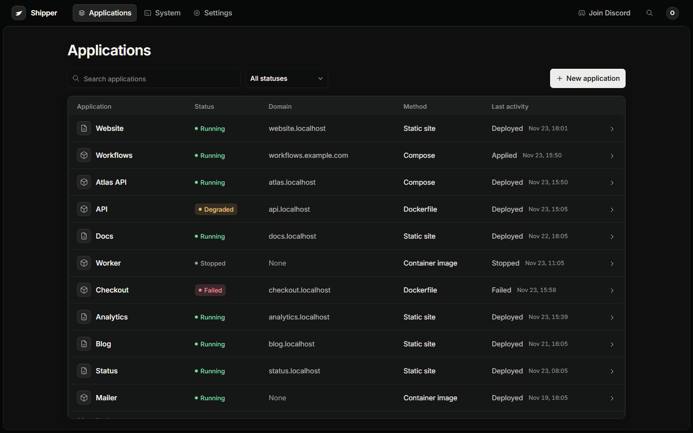
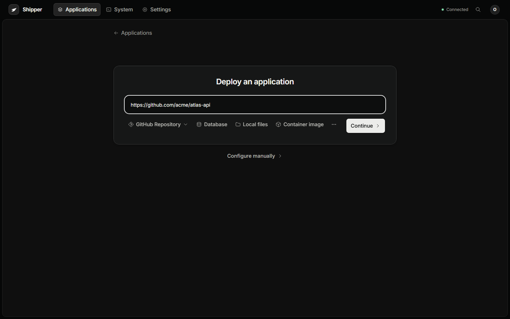
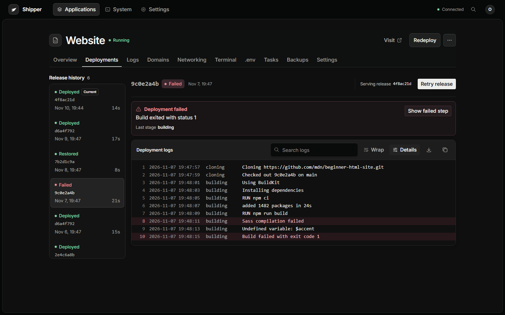
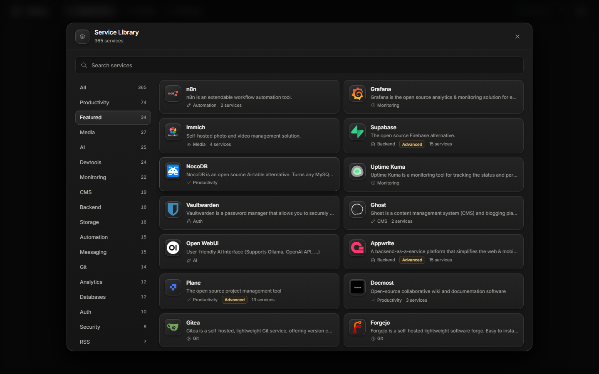
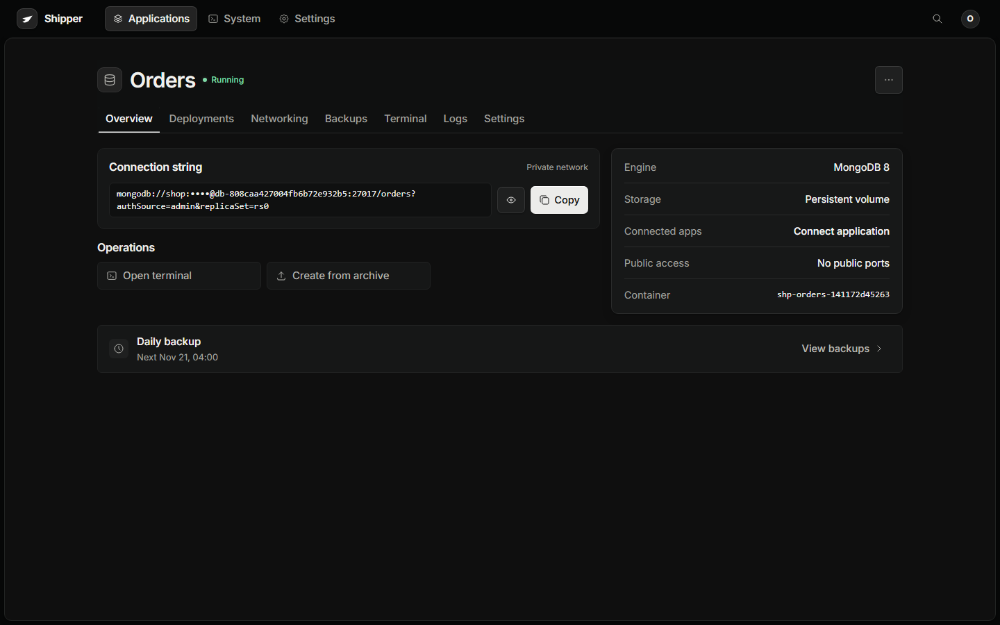
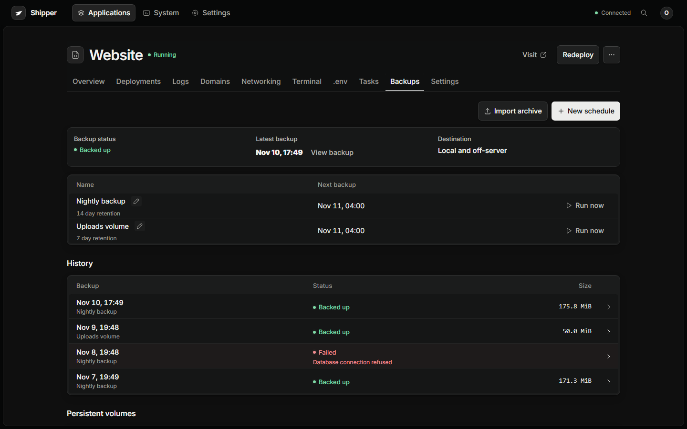

<p align="center">
  <a href="https://shipperkit.dev"></a>
</p>

<h1 align="center">ShipperKit</h1>

<p align="center">
  Deploy apps, databases and self-hosted services to your own server, with HTTPS, rollbacks and backups built in.
</p>

<p align="center">
  <a href="https://github.com/matyas-toth/shipperkit/releases"></a>
  <a href="https://github.com/matyas-toth/shipperkit/actions/workflows/ci.yml"></a>
  <a href="LICENSE"></a>
  <a href="https://discord.shipperkit.dev"></a>
</p>

<p align="center">
  <a href="https://shipperkit.dev">Website</a> ·
  <a href="https://shipperkit.dev/docs/">Docs</a> ·
  <a href="https://discord.shipperkit.dev">Discord</a>
</p>

## Install

Run this on a fresh Ubuntu or Debian server:

```sh
curl -fsSL https://shipperkit.dev/install.sh | sudo bash
```

Open the address it prints, paste the setup token and create your account. The installer supports Ubuntu 22.04 and 24.04 and Debian 12 and 13 on x86-64 or ARM64, with 1 GiB of RAM and ports 80, 443 and 8080 open. See the [prerequisites](https://shipperkit.dev/docs/prerequisites/) for the details.



## Features

### Deploy from anywhere

Paste a Git URL, pick a private GitHub repository, upload a local folder or run a container image, Dockerfile or Compose file. Shipper works out how to build it, and a push to your branch deploys it again.



### Releases that fail safely

A failed build never goes live. The previous release keeps serving while you read the exact line that broke, and any earlier release can be restored.



### Service Library

Deploy n8n, Immich, Supabase, Grafana, Uptime Kuma and 360 more services from a searchable library, with their secrets generated for you.



### Managed databases

Run PostgreSQL, MySQL, MariaDB, MongoDB, Redis, ClickHouse or SQLite with a ready connection string, credential rotation and scheduled backups. Databases stay on the private network until you give them a public domain.



### Backups and recovery

Back up databases and volumes on a schedule to the server or any S3-compatible storage, restore a backup as a separate copy, and recover the whole instance from an encrypted archive.



### Built for agents

The [`shipper` CLI](cli/README.md) and scoped tokens let you or your coding agent deploy, read logs and diagnose failures without SSH access to the server. Every command has a `--json` form.

```sh
shipper deploy . --name store --domain store.example.com
shipper logs store --follow
shipper doctor store
```

### And the rest

- Automatic HTTPS from Let's Encrypt, with aliases and redirects
- Live logs, a browser terminal, environment variables and scheduled tasks
- Teammates with Admin, Developer and Viewer roles, Google, GitHub and Discord sign-in, and two-factor authentication
- Updates from the dashboard that never take your applications down

## Support

Ask questions and share what you built on [Discord](https://discord.shipperkit.dev). Report bugs and request features in [GitHub issues](https://github.com/matyas-toth/shipperkit/issues), and report vulnerabilities privately as described in the [security policy](SECURITY.md).

---

## Development

Shipper is a Go control plane with a SolidJS dashboard. It keeps its state in SQLite, runs workloads through Docker and routes traffic with Traefik.

You need Go 1.27.4+, Node.js 22.12+ and Docker with Buildx and Compose.

```sh
npm ci
npm ci --prefix web
npm run dev
```

Open [localhost:5173](http://127.0.0.1:5173) and claim the instance with the token in `.shipper/setup-token`.

Before opening a pull request, run:

```sh
npm run check
npm test
node scripts/go.mjs vet ./...
npm run build
```

| Read | For |
| --- | --- |
| [Contributing](CONTRIBUTING.md) | Workflow, checks and writing rules |
| [Development](docs/development.md) | Configuration, the Docker package and the integration suites |
| [Architecture](docs/architecture.md) | How the control plane, deploy engine and proxy fit together |
| [API](docs/api.md) | The v1 API used by the dashboard, the CLI and agents |
| [Design](DESIGN.md) | The dashboard's design system |
| [Releases](docs/releases.md) | CI, release-please, staging and the installer channels |
| [All docs](docs/README.md) | Every developer document |

## License

ShipperKit is [MIT licensed](LICENSE). The Service Library is generated from Coolify's templates under the Apache 2.0 license. See [third-party notices](THIRD_PARTY_NOTICES.md).
