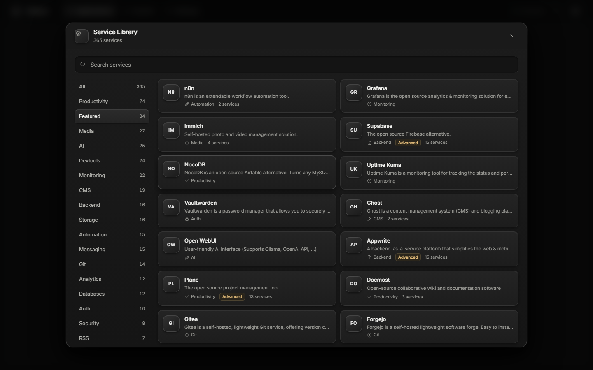
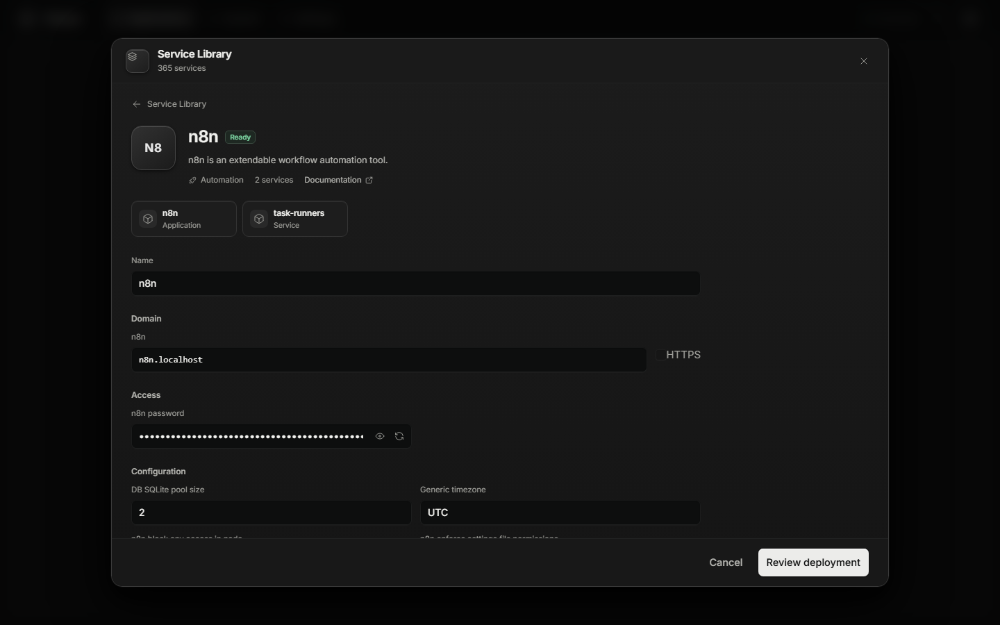

# Service Library

Shipper includes a maintained library of one-click service templates. The
library covers 365 services at the time of writing, including n8n, Ghost,
Grafana, Immich, Supabase, NocoDB, Uptime Kuma, WordPress and the common
databases.

Open it from **New application → Service Library**, or from the fourth card in
the manual source step. Pick a service, review the fields the template needs,
and continue through the normal deployment review.





## What the library changes

A library deployment is a normal Compose application:

- The catalog provides a Compose definition, a main service, exposed ports,
  health checks, service roles and a configuration schema.
- Shipper renders the definition into the application's own Compose snapshot.
  Later catalog updates never rewrite a deployed application.
- Domains, environment variables, credentials and service overrides are stored
  with the application like any other Compose configuration.
- A deployed library application gets a service console with access
  credentials, endpoints, documentation and generated settings.

Templates that need host access, a Docker socket or local configuration files
are marked **Advanced**. They remain selectable, but should be reviewed before
deploying.

## Configuration fields

The catalog exposes only variables that the template actually consumes.
Generated passwords use the browser's cryptographic random source and are
stored as secrets. The service console can reveal, copy and rotate them.

Domain fields map to Compose variables such as `SERVICE_FQDN_APP` and to the
application's routing table. A template with several FQDN variables for one
service receives the same public URL in each variable.

## Catalog updates

The catalog is embedded in the binary. Instances also fetch a published
manifest and cache it locally:

| Variable | Default | Purpose |
| --- | --- | --- |
| `SHIPPER_CATALOG_URL` | The repository manifest | Override the manifest URL, or set `off` to disable remote updates |

Refresh is attempted at most hourly. A failed or invalid manifest leaves the
last valid catalog in place. The cache lives in the data directory as
`service-catalog.json`. Restarting the instance retries immediately after a
short startup delay.

## Updating the catalog

The manifest is generated from Coolify's open-source service templates plus a
curated set:

```sh
go run ./cmd/cataloggen -source service-templates.json -out internal/catalog/catalog.json
```

`service-templates.json` is Coolify's generated
`templates/service-templates.json`. Read
[the attribution](../internal/catalog/ATTRIBUTION.md) before redistributing the
manifest.
